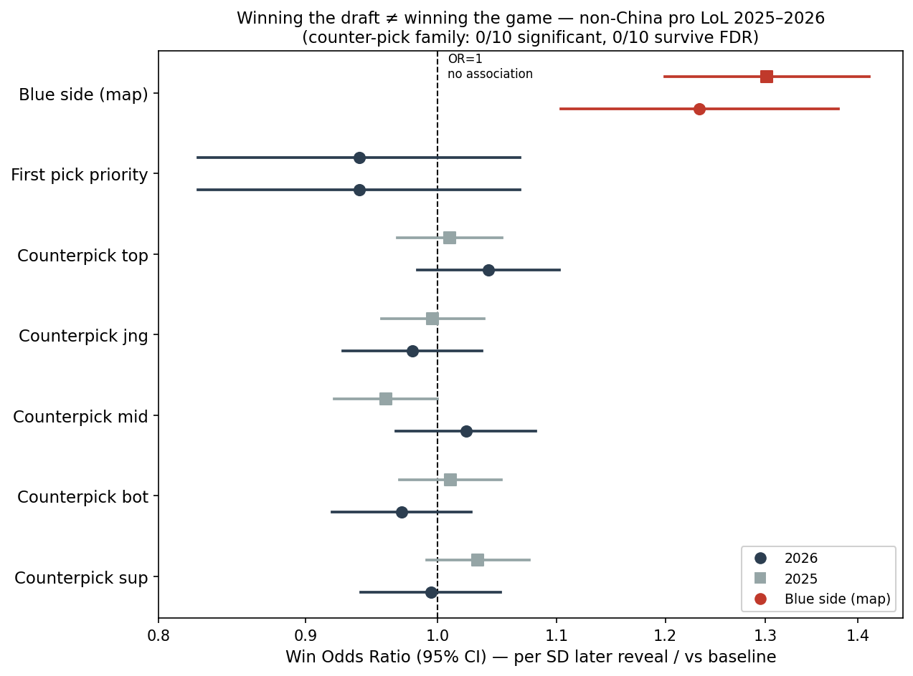

Historical draft (July 2026), superseded.
The sample of 84,548 team-games predates the LPLOL correction; numbers may differ
from `results/`. This document preserves an earlier research narrative, including
interpretations and plans that were subsequently revised. For current scope and
interpretation, use [METHODS.md](../METHODS.md) and [PAPER_STATUS.md](../PAPER_STATUS.md).
In particular, the current study reports observational associations and does not
identify causal mediation or a specific spatial mechanism.

# The Myth of Draft Advantage: Statistically Disentangling Map Side from Draft in Professional League of Legends

> **Data:** Oracle's Elixir professional match data from non-Chinese leagues. The main 2026 sample contains 5,000 games, 10,000 team-games, 35 leagues, and patches 16.01–16.10. Mechanism replication uses yearly 2022–2025 raw data, with approximately 8,600–10,400 non-Chinese games per year after removing LPL/LDL.
> **Unit:** One row per team per game; `result` indicates winning. Standard errors are clustered by `gameid` to account for mirrored team rows.
> **Predictor rule in the historical design:** Win models use draft-stage and information intended to describe the first 15 minutes, avoiding end-of-game explanatory variables. The current methods note clarifies that objective ownership lacks reliable event timestamps.
> **Status:** Topic selection and pilot validation were complete. This report also served as an outline for a research proposal. Reported values had been estimated, with the core mechanism examined across five seasons, 2022–2026 (§5.4).
> **July 2026 update:** Extensions included path analysis with game-cluster bootstrap intervals (§5.5), Elo controls (§5.6), a DiD event study of First Selection (§5.7), internal matchup-quality controls and TOST tests (§5.8), FDR correction for the counter-pick family, and data-integrity audits. Removing two void/remake games left 84,548 team-games. The historical reproducible package was named `map-side-vs-draft/`, with `python run_all.py` regenerating results. Method suitability, including why full SEM, IV, and RDD were not used, was discussed in `docs/METHODS.md`.

## 0. Abstract

Commentators, coaches, and viewers commonly attribute winning advantages to two
features of the professional League of Legends draft: first-pick priority, which
can secure a strong champion, and later counter-picking, which uses information
about the opponent's selection. This pilot used 2025–2026 Oracle's Elixir data
from non-Chinese leagues to distinguish map-side associations from draft-position
associations. The initial literature search found relatively little work that
separated these two dimensions directly.

Three pilot findings supported the proposed distinction: (1) later role-level
reveal timing had no significant positive win association in any of five roles
across two seasons, with ORs ranging approximately from 0.96 to 1.04; (2) first-pick
priority had no detectable independent association, OR approximately 0.94; and
(3) blue side had a positive association across seasons, OR approximately
1.23–1.31, p < 0.001. Riot's 2026 First Selection rule, which separates map side
from draft priority, supplied the variation needed to estimate the two separately.

Across the 2022–2026 pilot comparisons, blue side had greater early top-side
objective ownership, including a 15–25 percentage-point first-Herald advantage,
and a 15-minute gold lead of approximately 450–670 per year. Red side had a
14–24 percentage-point first-Dragon advantage, while team vision scores were
similar. These are historical sample estimates, superseded by the current outputs.

The historical framing was that champion-matchup quality could matter while
first-pick priority and reveal timing showed little independent win association.
The current manuscript treats these draft-timing results as supplementary and
avoids concluding that all counter-picking strategies are ineffective.

## 1. Research Questions and Positioning

### 1.1 Three core questions

1. Does later counter-pick timing, after seeing the opposing champion, translate into lane advantages and winning?
2. Does first-pick priority have an independent win association after controlling for map side?
3. How much of the blue-side association follows draft position, and how much follows map side?

### 1.2 Proposed contribution

The proposed contribution was not merely to document a blue-side advantage, which
had already been discussed in relation to map terrain, vision, objective access,
and camera perspective. It was to separate map-side and draft-position associations
statistically and quantify two early draft levers. This novelty claim required a
more complete literature review.

### 1.3 Narrative framework

The report distinguished two levels rather than asserting that drafting is useless:

| Level | Pilot finding | Proposed historical wording |
|---|---|---|
| Later reveal timing and first-pick priority: draft position/timing | ORs near 1, without a detectable positive association | Little independent conversion into wins in these models |
| Overall drafting and champion-matchup quality | Matchup quality may matter; iTero reported a difference of about 9 percentage points | Potentially smaller than commonly assumed |

The intention was to retain the distinction between a null timing association and
the broader value of champion selection. Non-significance alone does not establish
zero value; later equivalence tests applied explicit bounds (§5.8).

### 1.4 Broader research program

This study was linked to the project's weak-side top-lane and carry-top economic
threshold analyses under the theme *The Myth of Early Advantage*: early economic
leads, especially in top lane, and early draft-position advantages might be
systematically overvalued as indicators of final victory.

## 2. Background: Riot's 2026 First Selection Rule

The historical report described First Selection as introduced across regions from
14 January 2026, with LCK/LPL adopting it first. The selection holder chooses
either map side (blue/red) or draft order (first/second); the opponent chooses the
other dimension. The stated motivation was to reduce blue-side win-rate imbalance.

The rule mattered for this design in three ways:

1. It explained variation that had previously been absent. Under the earlier rule, first pick and blue side were collinear. Approximately 25% of 2026 games in the pilot had red-side first pick, enabling separate estimation rather than indicating a data error.
2. It made an assessment of the new rule timely: did the observed blue-side gap change, and what association did first-pick priority have with winning?
3. Assignment remained endogenous. Teams actively choose priorities, so the design provides statistical separation and a possible revealed-preference interpretation, not a randomized natural experiment. Selection-aware interpretation is required.

## 3. Literature and Novelty

The preliminary search covered OpenAlex, arXiv, IEEE Xplore, ACM Digital Library,
Springer, ScienceDirect, and major analytics websites.

Academic examples included *Feature Analysis to LoL Victory Prediction on the
Picks and Bans Phase*, *DraftRec*, and *Counter Relationships clustering*.
The initial review grouped work into draft-based prediction, recommendation,
champion balance, and player evaluation. It had not located a direct counterpart
to the proposed draft-timing and side/priority separation, but the search was
incomplete and could not establish that no such study existed.

Industry and blog comparisons included iTero's *Impact of Counters in Pro Play*,
which measured champion-matchup quality using solo-queue counter multipliers.
Its strong versus weak matchup groups had win rates of 54.4% and 45.6%, with a
professional effect approximately 40% as large as in solo queue. The PGA student
project, using counter-pick and ban counts, reported weak predictive performance.
Blue-side imbalance was already discussed in public analyses and Riot's rule change.

The proposed distinctions were:

1. Reveal timing/information rather than champion-matchup quality.
2. Statistical separation of first-pick priority and blue side.
3. Role-specific tests across all five roles.
4. An early empirical assessment of First Selection.

The search did not fully cover Google Scholar, paid full texts, or non-English
research, including Chinese and Korean. Exact Scholar searches and an explicit
Related Work comparison were still required.

## 4. Data and Methods

### 4.1 Outcome and controls

- Outcome: `result`, with win = 1.
- Standard errors: clustered by `gameid`.
- Robustness controls: `league`, `patch`, and `side` fixed effects where applicable.

### 4.2 Reconstructing later role-level reveal timing

Professional draft order follows this pattern, where the first-pick team holds
first-pick priority:

| Global pick | 1 | 2 | 3 | 4 | 5 | 6 | 7 | 8 | 9 | 10 |
|---|---|---|---|---|---|---|---|---|---|---|
| Team order | First | Second | Second | First | First | Second | Second | First | First | Second |

The reconstruction identifies each role's champion from player rows, locates that
champion in its team's `pick1–5`, and combines `firstPick` with the global order.
The role whose champion appears later receives the later-reveal label. For example,
if blue has first pick, blue top Gnar at `pick5` appears ninth, while red top Jax
at `pick3` appears sixth; Gnar is the later reveal.

This reconstructs observed timing. Flex picks can prevent it from identifying
what role information a team actually possessed before locking its champion.

### 4.3 Proposed improvement: matchup quality and intent

A later pick may seek a counter, complete a composition, preserve flexibility,
or choose a safe weak-side option. Timing alone does not distinguish those intents.
The proposal was to add historical solo-queue champion-versus-champion lane win
rates from sources such as lolalytics, u.gg, or counterstats.net, filtered by role,
rank, and patch, as an external matchup score:

| | Favorable matchup score | Neutral or unfavorable score |
|---|---|---|
| Later pick | Candidate targeted counter; test its outcome | Later pick that may complete the composition or seek safety |
| Earlier pick | Favorable matchup despite earlier reveal | Baseline case |

If timing remained near zero after adjusting for matchup quality, the result would
suggest that matchup quality was more informative than late reveal itself.
Use historical or aggregate matchup rates, never the current game's lane outcome
as its own pre-game predictor. Label the measure as solo-queue-defined matchup
quality, and align patches and champion names. Section 5.8 instead implemented an
internal, cross-fitted professional-data score.

### 4.4 Main models

- Role-specific model: `Logit(result ~ z(reveal_gap) + side [+ matchup_quality] [+ league/patch FE])`, with clustered standard errors.
- Priority/side separation: `Logit(result ~ firstPick + side)`, using 2026 variation.
- Relative contribution: use hierarchical or path-based summaries rather than interpreting pre-game and downstream variables as parallel causal competitors (§8).

## 5. Pilot Evidence, Including 2025 Replication

### 5.1 Later reveal timing across five roles and two seasons

Win odds ratios per one-standard-deviation later reveal, controlling for side and
clustering by game:

| Role | 2026 OR (p) | 2025 OR (p) | Later-reveal gold difference at minute 15, 2026 |
|---|---|---|---|
| Top | 1.042 (.16) | 1.009 (.68) | **−32** |
| Jungle | 0.980 (.48) | 0.995 (.83) | +33 |
| Mid | 1.023 (.43) | 0.960 (.055) | +27 |
| Bot | 0.972 (.31) | 1.012 (.56) | +9 |
| Support | 0.995 (.85) | 1.032 (.13) | −11 |

Across ten tests, ORs ranged approximately from 0.96 to 1.04 and none was
significantly positive. Mid and jungle later reveals had small gold associations
(+27/+33), while top had a negative association (−32), without a corresponding
positive win association in these models.

### 5.2 First-pick priority versus blue side in 2026

| Variable | OR | 95% CI | p |
|---|---|---|---|
| First-pick priority, `firstPick` | **0.939** | 0.83–1.07 | 0.34 |
| Blue side, 2026 | **1.233** | 1.10–1.38 | <0.001 |
| Blue side, 2025 replication | **1.308** | 1.20–1.42 | <0.001 |

The pilot found no detectable independent first-pick association and a positive
blue-side association. The historical interpretation was that first-pick status
did not explain the side gap and that the raw 52.6% blue win rate understated
pure map-side advantage. That latter causal interpretation is not established by
the observational design.

### 5.3 Key figure

The [draft-value forest plot](../../figures/fig1_forest_draft_value.png) places the
first-pick and five-role timing estimates from two seasons near OR = 1, while
blue-side estimates lie above 1. The historical numerical export is
`draft_odds_ratios_and_confidence_intervals.csv`.

### 5.4 Top-side objectives, Dragon, and vision across 2022–2026

Yearly pilot comparisons used approximately 8,600–10,400 non-Chinese games per year:

| Metric, blue minus red | 2022 | 2023 | 2024 | 2025 | 2026 |
|---|---|---|---|---|---|
| Win rate | +4.8 pp | +6.5 pp | +5.7 pp | +6.7 pp | +5.3 pp |
| First Dragon, `firstdragon` | −18.8 | −14.4 | −22.6 | −23.5 | −17.4 |
| First Herald, `firstherald` | +15.6 | +15.2 | +22.6 | +21.5 | +25.2 |
| First Tower, `firsttower` | +8.4 | +8.3 | +9.5 | +9.5 | +7.2 |
| Gold difference at minute 15, `golddiff15` | +495 | +603 | +669 | +485 | +453 |
| Team vision score, `visionscore` | +3 | +5 | +3 | +2 | −1 |

In all five seasons, red side owned first Dragon more often, by 14–24 percentage
points. Blue side owned first Herald more often, by 15–25 points, with more void
grubs, more first towers, and approximately +450–670 gold at minute 15.
Vision-score differences were small, approximately +2 to +5 in the earlier years
and −1 in 2026.

The historical mechanism hypothesis emphasized top-side resources and early
economy rather than Dragon or vision, relating top-river Herald/grub access and
bottom-river Dragon access to map position. It proposed that changing draft order
alone might leave a spatial source of imbalance intact. These spatial explanations
were hypotheses; the dataset does not identify objective access paths or their
causal effects.

### 5.5 Sequential decomposition and path analysis

The historical sequence was side → early objectives (Herald/Dragon) → minute-15
gold → first tower → outcome, fitted with linear probability models and
`gameid` clustering. Values are win-probability percentage points.

| Year | First Herald alone | Dragon alone, suppressor channel |
|---|---|---|
| 2022 | +2.5 pp | −3.2 pp |
| 2023 | +2.4 pp | −3.7 pp |
| 2024 | +6.0 pp | −3.6 pp |
| 2025 | +7.1 pp | −4.1 pp |
| 2026 | **+8.7 pp** | **−4.7 pp** |

Herald's standalone component ranged from +2.4 to +8.7 points, increasing from
+2.5 in 2022 to +8.7 in 2026. The report suggested that this might reflect greater
meta emphasis on top-side tempo. Dragon's component was negative in every year,
−3.2 to −4.7 points. Early economy contributed positively; first tower accounted
for a small share, 1–8%, in this sequential specification.

Exact objective-versus-economy shares depended on specification and year because
Herald and gold are correlated. Unexplained shares were approximately 13–58%.
The historical report treated these residuals as compatible with unobserved spatial
mechanisms and questioned whether a draft-only rule could address them. Residuals
alone do not identify those mechanisms.

The July 2026 extension in `src/mediation_path.py` used additive LPM path products
(a × b) and 600 bootstrap resamples of whole games, preserving the mirrored rows:

| Channel, 2026 | Path component | 95% CI |
|---|---|---|
| First Herald, positive channel | **+2.1 pp** | [+1.4, +2.8] |
| First Dragon, negative channel | **−1.9 pp** | [−2.4, −1.4] |
| Minute-15 gold | +2.6 pp | [+1.7, +3.6] |
| First Tower | +1.3 pp | [+0.8, +1.9] |
| Residual component | +1.2 pp | [−1.0, +3.6] |

The four named components excluded zero in 2026. In 2025, Herald was +2.4
[2.0, 3.0], Dragon −2.8 [−3.3, −2.3], and the residual +2.0 [0.4, 3.8].
These intervals supported the positive-Herald/negative-Dragon pattern under the
chosen associational model; they did not establish causal indirect effects.

The expanded-state check in `src/mediation_full.py` added nine observed state
channels, including first blood, void grubs, minute-10 gold/XP, and minute-15 XP.
The residual share remained approximately 23–36% in 2024–2026, similar to the
four-channel model. The historical report hypothesized a concentration in Herald
tempo and an unmeasured map-geometry source; testing coordinates and routes would
require timeline information unavailable in these Oracle's Elixir files.

### 5.6 Pre-match Elo controls

`src/team_strength.py` updated Elo chronologically within league-season, using
only information available before each match.

- Elo itself was predictive: OR **2.14** per SD of strength difference, McFadden R² = **0.079**.
- Under the 2022–2025 rules, the blue-side OR was stable or increased after adjustment: 2022 **1.211 → 1.215**; 2025 **1.308 → 1.425**.
- In 2026, the blue-side OR fell from **1.238 → 1.119**, 95% CI **[0.99, 1.26]**, p = **0.064**. The historical interpretation was selection by stronger teams into blue side, consistent with the endogeneity concern in §2, while acknowledging a smaller remaining association.
- The first-pick estimate remained non-significant: **0.941 → 0.928**, p = **0.28**.
- Nested McFadden R² in 2026 was **0.091** for strength, with **+0.0005** from map side and **+0.0007** from all tested draft-timing variables (priority plus five role gaps). The strength increment was approximately **130 times** the draft-timing increment.

These comparisons measure sensitivity to a strength control and model fit, not
causal shares of match outcomes.

### 5.7 Difference-in-differences event study: supplementary evidence

`src/did_first_selection.py` used cross-league variation in 2026 decoupling
intensity, approximately **D = 0.71** in LCK and **0** in LJL/AL, in a 2022–2026
league-season panel with league/year fixed effects and league-clustered errors.

- Main pilot DiD: **β = +3.9 pp** per unit of decoupling, 95% CI **[−4.4, +12.3]**, p = **0.36**. There was no detected reduction in the side gap; the positive point estimate was compatible with stronger teams choosing blue.
- Placebo outcome, blue first-Herald rate: **β = +2.0 pp**, p = **0.56**, approximately zero.
- The event study showed a pre-reform rise in 2024 of **+4.2 pp**, near the 2026 **+4.7 pp**. With imperfect parallel trends and a small panel, the DiD was only suggestive. The descriptive five-year OR range of **1.21–1.31**, including 2026, did not require a parallel-trends assumption.

### 5.8 Matchup quality and equivalence tests

`src/matchup_quality.py` implemented the §4.3 concept without external inputs.
Five-fold cross-fitting grouped by `gameid`, combined with empirical-Bayes shrinkage,
estimated expected minute-15 lane gold for each champion matchup from other games.
The resulting score was used as a matchup-quality predictor.

- Matchup quality predicted winning: top **OR = 1.047/SD**, p = **.005**; bot **OR = 1.102**, p **< 10⁻⁸**; support **OR = 1.043**, p = **.01**. Bot had the strongest association.
- After matchup adjustment, later reveal remained non-significant in all five roles: examples were top **1.023**, p = **.19**, and bot **1.002**, p = **.92**.
- Later timing did not consistently predict a more favorable matchup: top, bot, and support timing-to-matchup coefficients were negative, compatible with safe or weak-side selections.

The proposed distinction from iTero was that matchup quality could matter without
an additional benefit from revealing later.

`src/equivalence_tost.py` applied bounds **OR ∈ [0.909, 1.10]**:

- **10/10** role-season counter-pick timing tests passed equivalence within those bounds.
- Blue side did not pass equivalence, **p = 0.98**.
- First-pick priority did not pass equivalence. Its evidence was limited to the 2026 cross-section and had wider intervals, so it warranted only “no detectable association,” not a negligible-effect conclusion.

The role-season family also used Benjamini–Hochberg correction, with **0/10**
significant after FDR. Carry/bruiser/tank × later-reveal interactions were
non-significant: **2025 p = .92**, **2026 p = .33**. Findings were similar in
flex-pick robustness subsets and with league/patch fixed effects
(`src/robustness.py`). Equivalence applies to the specified timing proxies and
bounds, not all strategic counter-picking.

## 6. Candidate Explanations for the Null Timing Association

1. Later picks may prioritize safety or weak-side play rather than aggressive counters. The **−32** minute-15 top-lane gold association was consistent with some later top picks being defensive, scaling, or resource-conserving choices.
2. A later top selection may carry opportunity costs, such as allocating earlier priority elsewhere or accepting disadvantages in other roles.
3. Professional champion proficiency and team coordination may reduce the impact of matchup differences. iTero reported a professional counter effect around **40%** of its solo-queue counterpart.
4. Small lane-gold associations, such as mid/jungle **+27/+33**, may not translate into final wins, linking the question to the project's role and weak-side top analyses.

A proposed test was to connect later timing → lane advantage → final outcome using
matchup-quality data. These remain candidate explanations rather than identified
causal mechanisms.

## 7. Heterogeneity

Near-zero averages may conceal offsetting associations. Proposed dimensions were
champion class (carry versus tank top), patch/league, and matchup-strength strata.
Subgroup searches increase multiple-testing risk. An earlier champion economic-
efficiency heterogeneity test had **LR χ²(24) = 32.3, p = 0.12** and was not a
headline result. The five-role split had already produced no positive significant
timing association; champion class was proposed as the next dimension.

## 8. Relative Importance of Drafting

The proposed goal was to quantify the magnitude of draft-timing associations,
rather than describe them only as weak. Comparing `blue`, `firstPick`, and timing
with `team_gold@15` and Dragon in one regression does not estimate their parallel
causal importance: downstream states may absorb associations related to drafting.
The historical proposal used the sequence:

> Pre-match strength → draft → early state (gold/objectives) → outcome.

A Bradley–Terry/Elo strength score and hierarchical/commonality summaries were
proposed, potentially displayed as strength, draft, execution, and unexplained
components. Such a display would require careful interpretation and could not
by itself partition causal contributions.

The completed July 2026 nested-fit comparison (§5.6) was **0.091** for strength,
**+0.0005** for side, and **+0.0007** for all tested draft timing. This quantified
incremental fit in the particular model, rather than general causal importance.

## 9. Limitations and Historical Status

1. **Endogenous First Selection:** teams choose priorities, so selection bias requires a selection-aware or revealed-preference interpretation.
2. **Intent versus timing:** reveal order does not directly measure counter-pick intent; matchup-quality scores offer a partial adjustment.
3. **External matchup setting:** the proposed external rates were from solo queue rather than professional play, requiring patch and champion-name alignment.
4. **Flex picks:** a champion's ultimate role may differ from what an opponent knew at lock-in, weakening timing reconstruction. Role-clear subsets were proposed for sensitivity checks.
5. **Draft-order assumption:** reconstruction assumes the standard professional pick sequence.
6. **Incomplete literature search:** full Scholar coverage, paid full texts, and non-English research had not been covered.
7. **Decomposition sensitivity:** objective-versus-economy shares depend on specification/year. Unexplained shares of **13–58%** preclude one universal attribution percentage.
8. **Mechanism measurement:** Oracle's Elixir lacks coordinates and paths needed to test why a side gains objective access. Map geometry, camera angle, and routing remain hypotheses.

July 2026 status updates:

- Elo adjustment quantified sensitivity related to the First Selection concern: the 2026 side OR fell from approximately **1.24 to 1.12** (§5.6).
- Internal cross-fitted matchup scores reduced reliance on external solo-queue data (§5.8); lolalytics could provide complementary evidence later.
- Clean reconstruction and non-flex-top subsets had been checked, with similar conclusions.
- Bootstrap path intervals were added, and expanded-state residual shares remained **23–36%** (§5.5).
- First-pick priority failed TOST equivalence, so its null evidence was weaker than role-level timing equivalence. DiD parallel trends were imperfect and supported only supplementary interpretation.

## 10. Proposed Paper Structure and Outputs

- **Candidate title:** *Disentangling Map-Side from Draft: The Overestimated Value of Pick Priority and Counter-Picking in Professional League of Legends*, with an assessment of First Selection.
- **Structure:** introduction and rule change; related work distinguishing iTero/PGA and academic prediction; data and timing/matchup methods; results; candidate mechanisms; heterogeneity; incremental draft contribution; discussion and implications; limitations.
- **Figures:** existing forest plot; timing-related gold versus win associations; a 2×2 matchup-quality/timing win-rate table; contribution summaries; champion-class heterogeneity.
- **Possible venues:** MIT Sloan Sports Analytics, IEEE CoG, Journal of Sports Analytics, or undergraduate research/conference posters.

## 11. Next Steps Recorded in July 2026

1. Complete exact Scholar searches and write Related Work.
2. Prepare a formal manuscript in LaTeX or the submission format.
3. Optional extensions: external solo-queue matchup data and coordinate-based mechanism checks using the Riot API; these were not then being pursued.

## Appendix A. Reproduction Scripts and Data

The July 2026 package was `map-side-vs-draft/`. `python run_all.py` regenerated
results and figures, while `--from-raw` rebuilt the dataset first:

- Data construction and integrity: `src/build_dataset.py`, `src/audit_data.py`; void/remake removal left **84,548 team-games**, non-Chinese leagues, 2022–2026.
- Core models and FDR: `src/model_draft_value.py`; Elo: `src/team_strength.py` (§5.6).
- Path decomposition and bootstrap: `src/mediation_path.py`; expanded-state residuals: `src/mediation_full.py` (§5.5).
- DiD event study: `src/did_first_selection.py` (§5.7).
- Matchup quality and TOST: `src/matchup_quality.py`, `src/equivalence_tost.py` (§5.8).
- Robustness and figures: `src/robustness.py`, `src/figures.py` (fig1–fig7); methods: `docs/METHODS.md`.

Historical exploratory script locations in the original project were:

- `analysis/blue_side_mechanism.py`: yearly 2022–2026 side comparisons of objectives, vision, and gold (§5.4).
- `analysis/blue_side_mediation.py`: initial sequential LPM decomposition and separate Herald/Dragon components (§5.5).
- Raw yearly 2022–2026 files were stored in the original project's raw-data directory; 2022–2024 were downloaded from Oracle's Elixir, with LPL/LDL removed.
- Reconstruction and cross-year role timing: `supplementary/related_research/draft_exploration_archive/code/draft_explore.py`, `supplementary/related_research/draft_exploration_archive/code/draft_verify.py`.
- Forest plot and OR/CI export: `supplementary/related_research/draft_exploration_archive/code/draft_figure.py`; historical outputs were `draft_value_forest.png` and `draft_odds_ratios_and_confidence_intervals.csv`.
- Reveal order used `pick1–5`, `firstPick`, and the standard pick sequence. Logistic models standardized `reveal_gap`, controlled side, and clustered by game; the 2025 replication excluded LPL/LDL.

## Appendix B. Sources

- Riot First Selection: [Esports Insider](https://esportsinsider.com/2026/01/league-of-legends-side-selection-draft-order-revamp), [Esports Charts](https://escharts.com/news/first-selection-lol-esports-2026), [Leaguepedia: Right of First Selection](https://lol.fandom.com/wiki/Right_of_First_Selection).
- Industry matchup analyses: [iTero, Impact of Counters in Pro Play](https://medium.com/the-esports-analyst-club-by-itero-gaming/lol-the-impact-of-counters-in-pro-play-28a2e21ed2e0), [PGA project](https://viki-sh.github.io/League-Pregame_Analysis_Predictor/), [counterstats.net](https://www.counterstats.net/), [lolalytics](https://lolalytics.com/).
- Blue-side background: [UnrankedSmurfs](https://www.unrankedsmurfs.com/blog/lol-blue-side-advantage), [iTero side selection](https://www.itero.gg/articles/side-selection).
- Related academic work: [Feature Analysis on Picks-and-Bans (IEEE)](https://ieeexplore.ieee.org/document/9619019/), [DraftRec](https://arxiv.org/abs/2204.12750), [Counter Relationships clustering](https://arxiv.org/pdf/2408.17180), [SIDO Performance Model](https://arxiv.org/html/2403.04873v1).

This historical report consolidated exploratory analyses and revisions following
external feedback. Preliminary estimates had been run and checked against 2025.
The completion checklist included matchup-quality work, draft-contribution summaries,
and Scholar review; later updates within this draft recorded progress on some of
those items. The current methods and scope documents supersede this checklist.
